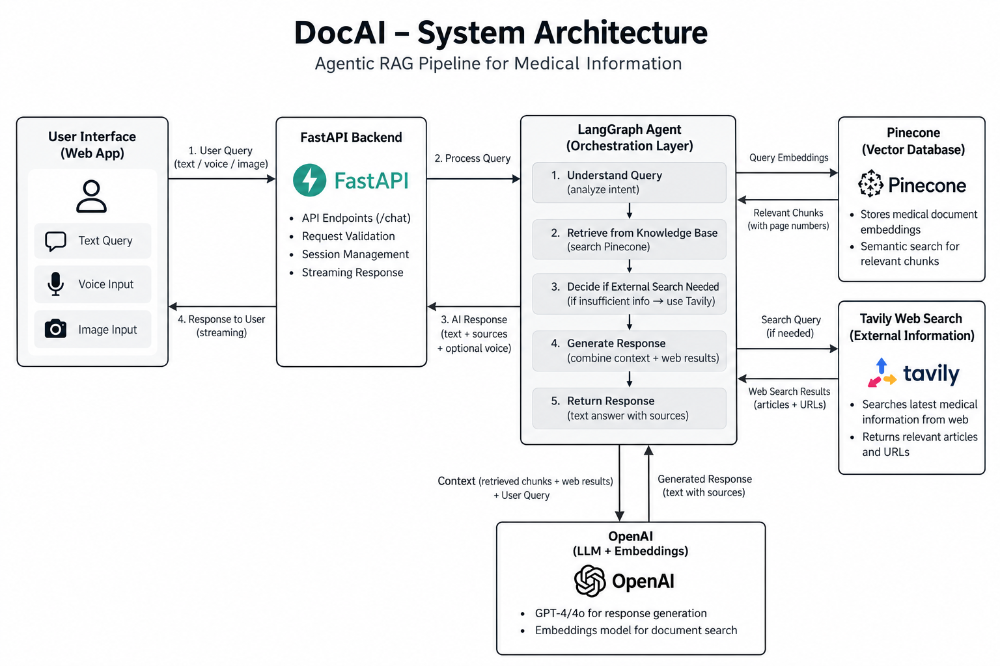

# DocAI — Agentic Medical AI Assistant

DocAI is an AI-powered medical assistant built using **LangGraph, OpenAI, Pinecone, Tavily, and FastAPI**. It combines retrieval-augmented generation (RAG) with web search to provide context-aware responses to medical queries.

## Architecture



## Tech Stack

| Technology | Purpose |
|---|---|
| Python | Application development |
| FastAPI | Backend API |
| LangGraph | Agent orchestration and workflow routing |
| OpenAI | Language model and embeddings |
| Pinecone | Vector database and semantic retrieval |
| Tavily | External web search |
| SQLite | Conversation checkpointing |
| DeepEval | Response quality evaluation |
| Vercel | Deployment |

## How It Works

1. **Query Processing:** FastAPI receives the user's question.
2. **Agent Orchestration:** LangGraph manages the workflow and query routing.
3. **Knowledge Retrieval:** Pinecone retrieves relevant information from the configured knowledge base.
4. **Web Search:** Tavily provides additional information when the agent selects the web-search path.
5. **Response Generation:** OpenAI generates a response using the available context.
6. **Evaluation:** DeepEval evaluates response quality and evidence grounding.

## Project Structure

```text
DocAI/
├── app/
│   ├── agent.py
│   ├── config.py
│   ├── knowledge.py
│   └── main.py
├── data/
├── docs/
├── static/
├── templates/
├── evals/
│   ├── dataset.json
│   ├── run_eval.py
│   └── test_eval.py
├── ingest.py
├── requirements.txt
├── test.py
├── architectures.png
└── README.md
```

## Getting Started

### 1. Clone the Repository

```bash
git clone https://github.com/Faheemmalla/DocAI.git
cd DocAI
```

### 2. Create a Virtual Environment

```bash
python3 -m venv .venv
source .venv/bin/activate
```

### 3. Install Dependencies

```bash
pip install -r requirements.txt
```

### 4. Configure Environment Variables

Create a `.env` file in the project root and configure the variables required by the application:

```env
OPENAI_API_KEY=
PINECONE_API_KEY=
TAVILY_API_KEY=
PINECONE_INDEX=
OPENAI_CHAT_MODEL=
OPENAI_EMBED_MODEL=
OPENAI_VISION_MODEL=
API_TOKEN=
ALLOWED_ORIGINS=
```

Set the appropriate values according to `app/config.py`. Never commit API keys or secrets to GitHub.

### 5. Ingest Knowledge-Base Documents

Configure your Pinecone index and ensure the source documents are available in the expected location.

Run:

```bash
python ingest.py
```

### 6. Run the Application

```bash
uvicorn app.main:app --reload
```

Open the application at `http://localhost:8000`.

## Evaluation

Run the DeepEval evaluation suite:

```bash
python evals/run_eval.py
```

Evaluation results help assess response quality and evidence grounding. They do not guarantee medical accuracy.

## Deployment

DocAI is deployed on Vercel. Configure the required environment variables in your Vercel project settings.

**Memory limitation:** The current deployment uses SQLite at `/tmp/medical_memory.db`. This storage is temporary and is not guaranteed to persist across deployments or serverless instances.

## Medical Disclaimer

DocAI is an experimental project intended for informational and educational purposes. It does not replace professional medical advice, diagnosis, or treatment. Always consult a qualified healthcare professional for medical concerns.

## Author

**Faheem Yousuf Malla**
